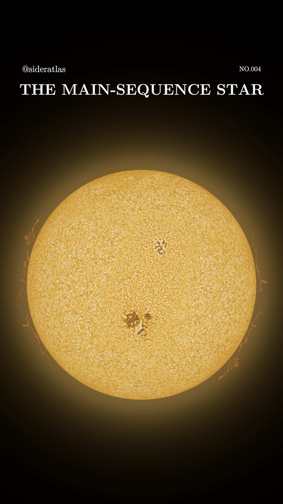

# SiderAtlas No.004 — The Main-Sequence Star

**Golden photosphere · four continuous camera orbits · v3.1.0**

<p align="center"></p>

[Download the final Reel and full bundle](https://github.com/Loganpis/sideratlas-main-sequence-star/releases/tag/v3.1.0)

One definitive **32-second, 1080 × 1920, 30 fps Reel**, with brighter warm-white granules, amber intergranular lanes, the existing coherent magnetic complex and separately exposed red-orange ultraviolet plasma. The only on-screen labels are THE MAIN-SEQUENCE STAR, @sideratlas and NO.004.

The camera makes exactly **four full turns: 360° every eight seconds**. The star stays centered and the same apparent size. All surface and atmospheric geometry remains anchored to the star. Source evolution runs continuously for 640 physical seconds; the camera does not reset the data or repeat an eight-second video segment. Physical stellar rotation remains a separate 25.38-day prescription.

The completed optical and C IV calculations are reused. This revision changes fixed presentation grading and viewing geometry, with finer UV depth quadrature for oblique views. It adds no new plasma activity or surface texture.

**Scientific scope:** independent local published radiation-MHD models are assembled on a sphere. The UV component is a finite-depth reconstruction of a **2.5D** model, and can look sheet-like from some angles. It is not a global 3D MHD star, a literal visible-light image or a newly calculated population of 3D jets. Magnification, contrast, false colors, optical halo, radiation approximations and source interpolation limits are disclosed.

- [Final Reel](https://github.com/Loganpis/sideratlas-main-sequence-star/releases/download/v3.1.0/sideratlas-no004-golden-orbit-32s.mp4)
- [Instagram caption](instagram-caption.text)
- [Physics, clocks and display parameters](docs/PHYSICS.md)
- [Scientific references and data attribution](docs/SOURCES.md)
- [Validation scope](docs/VALIDATION.md)
- [Camera, world anchoring, grading and sampling checks](validation/scientific-checks.json)
- [Full video verification](validation/sideratlas-no004-golden-orbit-32s-export.json)

## Reproduce

From the repository root, using the pinned dependencies and FFmpeg 8 with `libx264` and `zscale`:

```sh
python -m pip install -r requirements.txt
python reproduce_sources.py
NUMBA_NUM_THREADS=3 OPENBLAS_NUM_THREADS=1 python golden_orbit/validate.py
NUMBA_NUM_THREADS=3 OPENBLAS_NUM_THREADS=1 python golden_orbit/render.py --config config-final.json
python golden_orbit/validate_export.py
python golden_orbit/validate_orbits_export.py
```

Reproduction writes the film into `golden_orbit/output/`. The complete downloadable bundle includes the movie in `output/`. On GitHub, the movie and bundle are attached to the release to keep the source repository small. An eight-second, low-resolution whole-orbit check was reviewed before committing to the final render; its verification report is retained, with no alternative movie in the release.

Large MHD inputs and calculated radiation maps are retrieved/reproduced rather than redistributed. `reproduce_sources.py` checks the published source payloads against the optical and UV manifests. It requires substantial disk space, downloads and continuum-transfer time. Existing processed arrays can be reused. `golden/` contains the shared atmospheric, atomic and spherical-rendering support modules; `golden_orbit/` contains the one final renderer, configurations and new validation. Full native MHD simulations are not rerun.

The color LUT depends only on calculated intensity relative to a fixed initial limb law. It preserves linear CIE Y before the documented nonlinear imaging and tone mapping; the deliberate golden chromaticities are not the physical spectrum. UV intensity has its own false-color exposure. No physical optical-to-UV channel ratio can be inferred from the composite.

Original code is MIT licensed. Numerical data, atomic tables, CIE data and fonts retain their provider rights; MURaM attribution includes CC BY 3.0 and Stanford University Libraries. The [v3.1.0 release](https://github.com/Loganpis/sideratlas-main-sequence-star/releases/tag/v3.1.0) contains the verified final Reel and complete downloadable bundle.

`FILE-CHECKSUMS.json` identifies the source-repository files. The release’s `SHA256SUMS.txt` identifies the movie, downloadable ZIP and caption. The movie is included in the ZIP, but stored as a release asset rather than in Git history.
