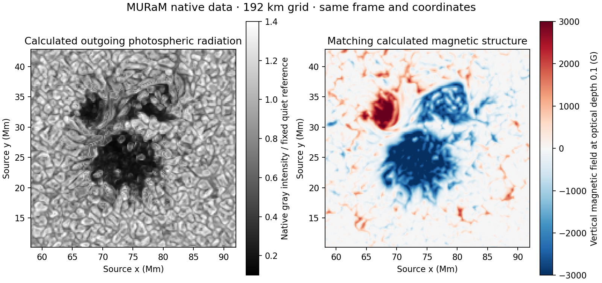

# Native active-region data and what it adds

[Cheung et al. (2019; published online 2018)](https://doi.org/10.1038/s41550-018-0629-3) released the numeric MURaM outputs through the [Stanford Digital Repository](https://purl.stanford.edu/dv883vb9686), **CC BY 3.0**. Required institutional attribution: Provided by the Stanford University Libraries. Credit: M. C. M. Cheung, M. Rempel, G. Chintzoglou, F. Chen, P. Testa, J. Martínez-Sykora, A. Sainz Dalda, M. L. DeRosa, A. Malanushenko, V. Hansteen, B. De Pontieu, M. Carlsson, B. Gudiksen, and S. W. McIntosh. This visualization modifies their data through normalization, temporal/spatial interpolation, spherical projection, documented contrast enhancement and optical imaging.

Only outgoing **photospheric** gray intensity and photospheric magnetic slices are used. The source study includes a corona and a flare, but those channels are not drawn. This is a visualization of the selected photospheric sequence, not a simulation of prominences or flare radiation.

`I_out_every200steps.tar` contains 300 frames with actual timestamps from 26729.535 to 30668.799 s. Its SHA-256 is `90c7afc88f93d4092f63152c5aaa3019e51e9b275db14edc2152e5f5bcb0482e`. The layout is the documented four-float header plus a 512 × 256 little-endian float32 image. The paper's 98.304 × 49.152 Mm domain gives 192 km sampling. Initial exploratory coordinates based on 384 km were discarded before the delivered preview and final render; only the confirmed 192 km scale is used.

Matching `tau_slice_0.100` fields have ten planes. The supplied authors' reader identifies planes 5,6,7 as horizontal x, **vertical z**, horizontal y, with multiplication by √(4π) giving gauss. Exact member names, timestamps, byte ranges and hashes are checked during retrieval. This prevents accidentally interpreting a horizontal field component as the vertical one.

For the chosen first-frame patch:

| Radiation class, defined only for validation | Median total field | Native mean radiation / quiet |
|---|---:|---:|
| Dark cores, I < 0.5 I_quiet | 2.97 kG | 0.306 |
| Magnetized intermediate-intensity structure | 1.29 kG | 0.724 |
| Bright points, I > 1.1 I_quiet and vertical field >500 G | 1.45 kG | 1.185 |

The intermediate-intensity class is not a perfect penumbral segmentation. Fine filaments are limited by the source grid. These classes validate the magnetic association of features; **they do not define rendering masks**. The rendered radiation is sampled directly from the full intensity map.

After 320 s, the weak-field patch's fixed-position intensity correlation drops to about 0.078, while the whole patch remains more correlated (about 0.70) because the large dark cores persist. This is the desired multiscale behavior: changing convection around more persistent magnetic structure. It is not an imposed lifetime or a synthetic noise model.

Holding out alternating actual snapshots and interpolating their neighbors gives mean RMS error about 1.29% of the fixed quiet reference, with the largest tested frame-average RMS about 1.83%. Individual local errors can be greater. Neutral contrast-one sampling recovers native outgoing gray intensity after the declared spectral factor with relative luminance error below 2 × 10⁻⁸ in the tested ray.

The gray radiation and native magnetic geometry are calculated. The full-star placement, patch blending, 10× magnification, display contrast, thermal color proxy thermal optical-band correction and active-region limb approximation are prescribed. The native vertical bright points should not be presented as a quantitative prediction of directional facular contrast near the limb. No unmodeled extended magnetic filaments are added to the photosphere.

Figure: unenhanced native MURaM gray radiation and the matching vertical field, generated from the cited CC BY 3.0 data. The colored field map is documentation only and never appears in the Reel.
